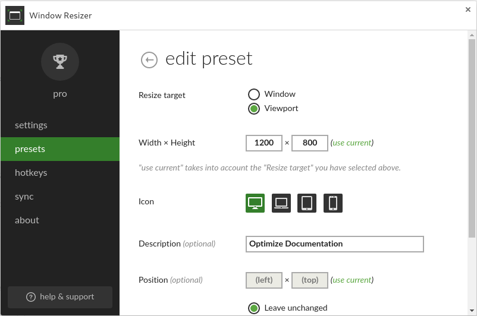

# The Cawemo Documentation Sources

This repository contains the sources of the Cawemo Documentation.

**Important:** _do NOT change the content of `themes/camunda` directory directly!_
Instead, Change the [theme](//github.com/camunda/camunda-docs-theme).

## Installing Local Development Tools With asdf

Use [asdf](https://github.com/asdf-vm/asdf) that selects tool versions based on [.tool-versions](.tool-versions)

On first use, install the plugins listed in [.tool-versions](.tool-versions) with `asdf plugin add <plugin name>`.
Then install all package versions listed in [.tool-versions](.tool-versions) with `asdf install`.

See [Having issues?](https://asdf-vm.com/#/core-manage-asdf?id=having-issues) if the versions of tools
installed via asdf are not being used.

### Install `hugo` with `asdf` on Macs with Apple Silicon

The version of `hugo` used in this repository is outdated and does not provide native `arm64` binaries.
That is why you'll see the following error when trying to install `hugo` with `asdf` on Macs with Apple Silicon:

```
asdf-hugo: Could not download https://github.com/gohugoio/hugo/releases/download/v0.54.0/hugo_0.54.0_macOS-ARM64.tar.gz
```

As a workaround, you can install the `amd64` binaries instead:
- Enter a new shell described here https://github.com/asdf-vm/asdf/issues/834#issuecomment-924682825 for instructions on how to do so).
- Run `. $(brew --prefix asdf)/libexec/asdf.sh`
- Run `asdf install`

## Building The Documentation

After you have installed hugo, you can build the docs by typing the following command:

```bash
hugo
```

A static build of the documentation will be placed in the `public/` folder.

While editing the docs, you probably want to start the hugo server (defaults to "watch mode"):

```bash
hugo server --baseUrl="http://localhost"
```

You can then browse the docs under [http://localhost:1313/](http://localhost:1313/).
Hugo will automatically detect when you change a file and refresh the page in the browser.

## Native publishing: Draft, manual-only, not activated

The proposed GitHub Actions publisher is **Draft-PR-ready infrastructure, not an
activation or a successful deployment**. It changes no product content, installation
release, download bundle, Jenkins configuration, or Static configuration. Cawemo
`1.9` remains source-owned (currently **1.9.43**, including the ZIP and TAR.GZ).
The old master-only PR workflow is unchanged; the new unprivileged
`docs-cawemo-checks.yml` covers PRs targeting `1.9`, with offline tests and a full
pinned shared Hugo 0.54 build. It has no Vault or OIDC/write permission.

### Prerequisites before merging/activating any real publication

Keep this change in Draft until the owners have reviewed:

* A Cawemo-scoped Vault JWT role/policy and `VAULT_ADDR`, `VAULT_JWT_ROLE`,
  `VAULT_JWT_PATH`, `VAULT_JWT_AUDIENCE` Actions secrets. **Do not assume the role
  exists.** Bind trusted workflow/repository/ref identities and audience explicitly;
  never authorize fork PRs or arbitrary workflow refs. Dispatch only reviewed,
  trusted workflow tooling (normally the merged `1.9` branch).
* Access to the private pinned Static resolver/reusable smoke workflow and shared
  actions. The Static workflow's cross-repository checkout requires the established
  Vault-backed GitHub App credentials and read installation access to
  `camunda-docs-static`; the caller's token is not a private-repository fallback.
  The pinned Static workflow uses `job.workflow_repository`/`job.workflow_sha`;
  verify platform support and workflow-access policy before activation.
* Existing keys under `secret/data/products/cambpm/ci/docs`:
  `DOCS_PUBLISH_DEFAULT_DESTINATIONS` for auto, common `DOCS_SSH_USER`,
  `DOCS_SSH_PRIVATE_KEY`, `DOCS_SSH_KNOWN_HOSTS`, `DOCS_STAGE_ROOT`,
  `DOCS_LIVE_ROOT`, Legacy `DOCS_SSH_HOST`, and AWS `DOCS_AWS_SSH_HOST` plus
  `DOCS_AWS_SMOKE_RESOLVE`. Values stay job-local and missing/invalid values fail.
  AWS SSH must be `webserver-docs.camunda-it.rocks`; the approved HTTP IP comes
  only from Vault. No secret values belong in source or dispatch inputs.
  These names reuse the docs KV contract; Cawemo access, host/route/root/
  known-host pins and its JWT role/policy are **not assumed provisioned**.
* A non-root SSH user, pre-existing distinct/non-overlapping absolute Stage/Live
  roots, trusted provisioned known-host entries, remote Python 3 and **standard
  rsync**. Missing/unsupported tools fail; there is no alternate transfer.
  Symlinked roots/parents, linked/special files, unsafe paths and file parents fail.
  No TOFU, `ssh-keyscan`, root-wide transfer, or deletion is used.
* Stage/Live virtual-host isolation, canonical TLS certificates, exact Static
  Cawemo redirect contracts, and the ability to serve
  `cawemo/1.9/cawemo-publish-manifest.json` as JSON. Cawemo cannot repair those
  shared hosting contracts. Test routing and permissions through an approved
  operational process, not by assuming a dry-run proves them.
* **Writer freeze:** separately neutralize/coordinate Jenkins, legacy/manual
  publishers, maintenance dispatches and other writers before any real run.
  `docs-cawemo` serializes this publisher, not those external writers or other
  products' global smoke suites. This is not a cross-system transaction.
  Inventory existing download retention, filesystem links and resource sizes.
* **Explicit activation:** the repository Actions variable
  `DOCS_CAWEMO_NATIVE_ENABLED` must equal exactly `true` for any real Stage or
  Live run. Unset, `false`, or malformed values fail closed before remote work;
  dry runs remain available. This mirrors Optimize's existing
  `DOCS_OPTIMIZE_NATIVE_ENABLED` opt-in, not a new Vault/default setting.
  Do not set it as part of merging this PR. Owners must first attest the writer
  freeze, permissions and approved Stage-to-Live provenance handoff.

### Jenkins facade compatibility: blocked pending provenance handoff

Reuse Jenkins' existing `GhaWorkflowDispatch` and `GhaRunWaiterJobGenerator`
against the trusted owner ref `1.9`; no second API client or Maintenance slice
is needed merely to dispatch and wait. Do not activate this route yet.
The existing parameterless `camunda-docs-release (cawemo-1.9)` cannot supply this
workflow's four mandatory trusted Stage provenance values. An approved, exact
successful-Stage handoff is required before replacing that backend. Do not
weaken provenance checks, infer a latest run, or add an unreviewed operator
interface to conceal this gap.

Keep current Jenkins names, version-specific source-push triggers and downstream
smoke intact until a coordinated handover. The GHA entrypoints remain
dispatch-only: merging this source does not add an automatic publisher, and
owners must keep the activation variable unset/disabled. The future Jenkins backend
selection must also default to Legacy until separately authorized, using a
generation-time opt-in like the existing native-release facade. Never enable
current-version GHA for historical `1.0`-`1.8` jobs.

### Stage

`docs-cawemo-stage.yml` has **only `workflow_dispatch`**, version `1.9` only.
Choose `auto`, `legacy`, `dual` or `aws`; auto/default resolution reuses Static
`7a717518ad8f395ab4cc81dfdc65da4b7f2e2f03`. **Dry-run defaults to true**.
Stage and promotion hold the same whole-run `docs-cawemo` lock, with
`queue: max` and cancellation disabled. The numeric destination matrix has
`fail-fast: false`; one failed destination cannot silently cancel its sibling.

The selected `1.9` source resolves once to an immutable SHA; workflow tooling
is checked out separately at trusted `github.sha`. One build uses
`docs-hugo-build@689027f45f5e565999c9b2e0c4294a18669c4a66` and Hugo **0.54.0**,
then the pinned Jenkins-equivalent link checker
`cccb09bbc59bed8fdf5ef7122be148fb57a70c8e`, retaining ignore expression
`^/(optimize|manual|cawemo|security|get-started|enterprise)`.
Generated installation links must match the selected source's download names,
and generated bundle bytes must equal its static bundles.

The build adds a canonical manifest containing every output file's size/SHA-256,
source/tooling SHA, repository, version and Stage run ID. Its SHA-256 and the TAR
SHA-256 are **trusted build job outputs**, not checksums found inside an artifact.
Extraction verifies that archive digest before writing; absolute/traversal,
duplicate, symlink/hardlink/special, sparse/PAX, file-parent and oversized entries
fail closed. No remote archives are ever downloaded for extraction.

A real Stage run transfers only `cawemo/1.9`, non-deleting, then independently
requires both the product gate and the pinned global Static smoke workflow.
The product gate checks the exact trusted manifest, every expected file's bytes,
direct HTTP 200 ZIP/TAR responses, exact installation and locally fingerprinted
CSS/JS, plus these exact redirect contracts (Stage and Live):

| Request | Status | Exact same-host target |
| --- | --- | --- |
| `/cawemo/` | 301 | `/cawemo/1.9/` |
| `/cawemo/technical-guide/installation/` | 307 | `/cawemo/1.9/technical-guide/installation/` |
| `/cawemo/99.0/technical-guide/installation/` | 307 | `/cawemo/1.9/technical-guide/installation/` |

Canonical HTTPS hostnames, TLS/SNI and certificate verification are preserved.
AWS curl requests have the selected canonical host pinned with `--resolve` to
the required approved Vault IP, with no DNS fallback. Only Legacy uses canonical
public DNS. Proxies, curlrc, insecure TLS and blind redirect following are
disabled; HTML/version-root redirects cannot satisfy a download check.
The product checker requires curl **8.4.0 or newer** (streaming/chunked
`--max-filesize` enforcement); older or unidentified curl fails before a request.

### Promote existing Stage to Live

`docs-cawemo-promote.yml` is also dispatch-only, version `1.9`, dry-run true by
default, with no rebuild. For a real run, copy these four values **from the
reviewed successful real Stage run's trusted BUILD output/summary**:
`source-sha`, `tooling-sha`, `stage-run-id`, `manifest-sha256`. Inspect the
destination and final aggregate results too. Do not copy values from a remote
manifest, download sidecar, untrusted artifact, PR log or a dry-run as evidence
of Stage success. This deliberately requires an authorized operator to bind
promotion to a trusted Stage build; there is no cross-run artifact/API discovery.

Set the desired destinations explicitly after reviewing the effective selection.
Real Live additionally requires `confirm-live-promote` to equal exactly
`promote cawemo docs 1.9 to live` (case/spacing matter).
Each selected destination must independently pass **both** current Stage product
and global gates. Immediately before copying, the transfer rechecks that same
destination's Stage HTTPS bytes and verifies the SSH Stage files against that
same trusted manifest. A same-host remote rsync promotes **only manifest-listed
files within `cawemo/1.9`**, never a local rebuild or a different destination.
Remote post-copy hashes and independent Live product/global gates must match
the same expected build. Missing provenance or any failed/skipped/cancelled
required gate fails the destination and strict final aggregate.

### Retention and recovery limitations

The shared `docs-rsync@689027f...` always deletes and has no preservation input,
so this publisher deliberately uses a small strict-SSH **non-deleting** transfer.
Older downloads such as 1.9.42 and all other version directories remain untouched.
Promotion's trusted file list also prevents unmanifested older Stage downloads
from overwriting older Live files. Existing extra resources are not expected
manifest entries and are **retained**, not accepted as evidence of a build.
Stale extra resources can therefore remain reachable; a full audited retention/
cleanup decision is deferred. Never manually add `--delete*` to this path.

There is no automatic rollback or atomic multi-destination cutover. A transfer or
post-publication gate failure may leave one destination partially changed while
another succeeds. Inspect scopes, expected manifest and independent summaries,
coordinate other writers, and recover only through a reviewed scoped operation.
Hash checks do not eliminate races with external writers; keep the writer freeze
through all gates. Bounds are explicit: 4,096 build files, 8,192 tree/archive
entries, 32 MiB/file, 256 MiB build/archive content, 2 MiB manifest, and a
512 MiB remote scope (including retained extras), plus command/job timeouts.
Crossing a bound needs review, not a fallback.

**Dry-run means plan/local validation only:** builds and local files are allowed,
but there is no SSH connection, remote mkdir/write, promotion or real HTTP/global
gate. Required real gates are deliberately recorded as skipped, **never smoke
passed**. Vault and action/dependency reads may still be required. Do not infer
remote connectivity, permissions, retention inventory or deployment success.

### Local offline validation

```bash
python3 -m unittest discover -s tests/publishing -v
python3 -m py_compile .github/scripts/cawemo_*.py tests/publishing/test_publishing.py
git diff --check
actionlint .github/workflows/docs-cawemo-*.yml
```

Tests use standard-library fixtures only, under `.local-validation/`, with real
malicious TARs, adversarial HTTP/status/hash/redirect cases, strict SSH/path checks,
non-deleting rsync stubs (no SSH), retention checks and gate/wiring failures.
Use exact Hugo **0.54.0**, not a newer host binary, for a full local build and
manifest round trip. Do not run the shared external link crawler or destination
smoke as an “offline” test.

Stock actionlint 1.7.12 rejects the required `concurrency.queue` key; keep the key.
Record that baseline incompatibility rather than claiming a clean stock lint.
An additional run with `-ignore 'unexpected key "queue"'` checks the remaining
local workflow/shell syntax; it does not validate private action access, the
remote reusable workflow's newer job contexts, Vault policy or GitHub runtime.
The unchanged legacy `pr-check.yml` also has a stock actionlint baseline error
for its obsolete checkout v2 action; it is outside this publisher change.

## Writing Docs

Some guidelines for writing docs

### How Can I Add an Image?

#### Where Should I Put the Image?

Images should be put next to the content page which references them.

So, if you have a file named `user-guide/configuration/overview.md` and you want to add an image named `architecture-overview.png` then it should be placed in the same folder.

#### How Can I Reference the Image?

Use the `img` shorthand:

```html

```

### How Can I Add a Note?

Use the `note` shorthand:

```html
 The content of the note. * full *
markdown is supported 
```

Supported classes:

- `info`
- `warning`

### How Can I Highlight Code Lines

By using the `code` which can highlight 1 line or a range of lines (and you can set that multiple times).

```html
<?xml version="1.0" encoding="UTF-8"
standalone="yes"?>
<cmmn:definitions
  id="_d7e7cad4-86f1-4c04-9dff-a9aace3afb61"
  targetNamespace="http://cmmn.org"
  xmlns:cmmn="http://www.omg.org/spec/CMMN/20151109/MODEL"
  xmlns:xsi="http://www.w3.org/2001/XMLSchema-instance"
  xmlns:camunda="http://camunda.org/schema/1.0/cmmn"
>
  <cmmn:case id="loan_application">
    <cmmn:casePlanModel
      autoComplete="false"
      name="Loan Application"
      id="CasePlanModel"
    >
      <!-- Plan Items -->
      <cmmn:planItem definitionRef="HumanTask_1" id="PI_HumanTask_1" />

      <!-- ... -->
    </cmmn:casePlanModel>
  </cmmn:case> </cmmn:definitions
>
```

## How Do I Make Screenshots for Documentation

### Setup

In Chrome browser install the following two extensions:

- Window resizer: to resize the view/window page to the require resolution
- Fireshot: to take the actual screenshot

In order to speed up the window resizing process, it can make sense to define a preset in the window resizer addon. Make sure that resize target is _Viewport_ and the resolution is _1200x800_. See an example of the configuration here:


### How to Create a Screenshot

The following procedure ensures that all screenshot are consistent:

1. Go to the page you want to take a screenshot of
2. Use the window resizer to adjust the size to _1200x800_. Make sure the window target is set to viewport!
3. Use fireshot to take a screenshot of the visible page and save it.
4. Go to [google docs drawings](https://docs.google.com/drawings) and create a new drawing document.
5. Here click on the _file_ menu entry and then choose the page setup. In the opening modal you can set the resolution to _1200x800_.
6. Paste the saved screenshot and adjust it to the canvas size.
7. Optional you can add boxes and arrows for explanation:

- use standard rectangular boxes with the default background color
- use default arrows with a line weight of 2px

8. Click on the _file_ menu entry and choose download as: _PNG image_

## How Do I Adapt the Architecture Overview Diagram?

The Architecture Overview Diagram was created with [diagrams.net][diagrams.net] after [the C4 model for visualising software architecture][C4 model].
1. Open https://app.diagrams.net.
1. Import [the diagram's XML file](./content/technical-guide/architecture.drawio) via the _File > Open From > Device..._ menu entry.
1. Make your changes.
1. Export the diagram via the _File > Export As > XML..._ menu entry.
1. Export the diagram via the _File > Export As > PNG..._ menu entry. Make sure to adjust the zoom to 200%.
1. Replace [the diagram's XML file](./content/technical-guide/architecture.drawio) and [the diagram's PNG file](./content/technical-guide/architecture.png) with the exported files.

## Writing Guidelines

- Use short sentences. Full stop is better than comma.
- Don't constantly repeat context: One a Page named _Updating Camunda_ not every headline needs to start with _"Updating this"_, _"Updating that"_. Instead just write _"This"_ or _"That"_. It is clear to the reader that things are being updated. Other example: if the page is named _"Installing the Full Distribution for JBoss Application Server"_ not every section needs to mention the application server: Instead of _"The following steps are necessary in order to install the REST Api on JBoss"_ write: _"The following steps are necessary in order to install the REST Api:"_
- Don't overuse notes and warning. Not everything that comes into mind while writing a paragraph is a note or a warning. Maybe it is just content. There should not be more notes and warnings than content.
- Yes, you programmed the stuff but you don't need to write the docs in a super self-conscious way: instead of _"We use slf4j for logging"_ write: _"Slf4j is used for logging"_.
- Don't use the future form: instead of _"This document will guide you through he steps of..."_ write _"This document guides you through the steps"_
- Nice combination of the previous two points: _"Throughout this guide, we will use a number of variables to denote common path names and constants:"_ => _"This guide uses the following variables to denote common path names and constants:"_
- Use this tool to convert titles into title case: [title converter][title converter]

## License

<a rel="license" href="http://creativecommons.org/licenses/by-sa/3.0/"></a> The content on this site is licensed under a <a rel="license" href="http://creativecommons.org/licenses/by-sa/3.0/">Creative Commons Attribution-ShareAlike 3.0 Unported License</a>.

[c4 model]: https://c4model.com/
[camunda nexus]: https://artifacts.camunda.com/artifactory/thirdparty/hugo/
[diagrams.net]: https://diagrams.net
[hugo]: http://gohugo.io/
[title converter]: http://individed.com/code/to-title-case/
